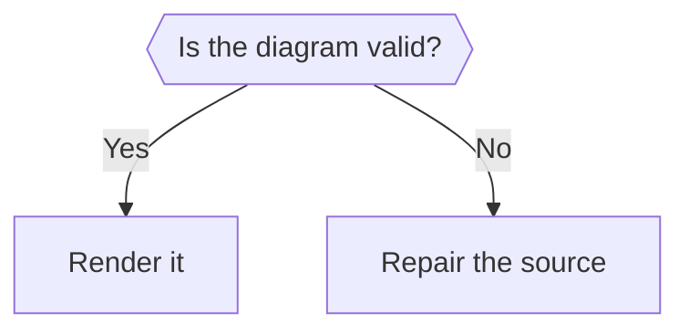
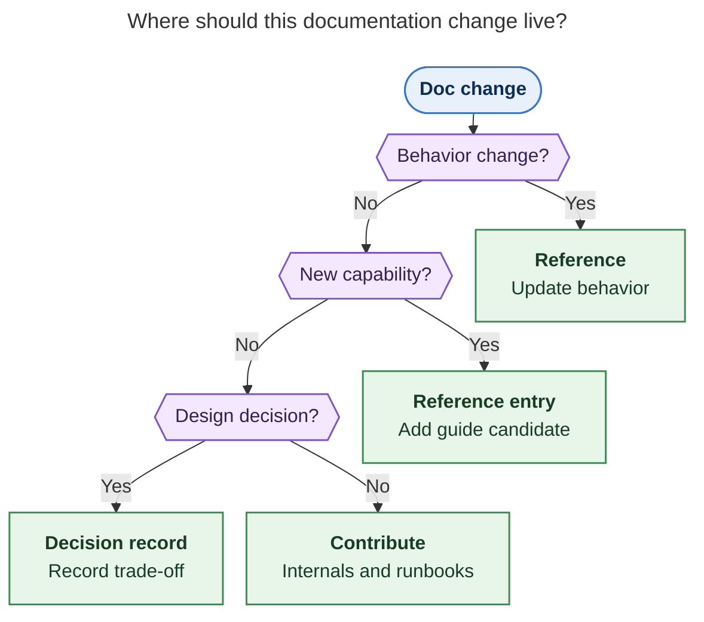

```mermaid
---
title: "Auto follows content; a lock holds the layout"
---
stateDiagram-v2
  direction TB
  state "Auto spread" as AutoSpread
  state "Auto paged" as AutoPaged
  state "Locked paged" as LockedPaged
  AutoSpread --> AutoPaged: content > 1.65 screens
  AutoSpread --> LockedPaged: P picks wider layout
  LockedPaged --> AutoPaged: palette returns to auto
```

# Mermaid diagram craft

Use these rules when deciding whether to draw, choosing a diagram type, and checking a
render. A figure earns space by making a relationship easier to see than prose.

## Know the one thing the figure says

- Write the reader question first, because a figure without a question has no test of
  usefulness.
- Write one sentence that answers the question, because it will become the caption.
- Gather the source passages for every node and relation, because a tidy picture can still
  invent a claim.
- Draw when the answer depends on order, branching, state, ownership, or before and after,
  because those relationships benefit from spatial form.
- Use one sentence of prose when it answers the question fully, because a diagram should
  earn its reading time.
- Rank candidates by how much the report's conclusion depends on each answer, because the
  central reasoning matters more than a detailed side path.
- Keep a candidate list before choosing figures, because comparing alternatives improves
  selection.
- Let a survey report have zero figures when no reader question needs a picture, because
  the cap is not a quota.

## Choose the type from the content's shape

- Use `flowchart TD` for a decision or routing rule, because questions and labelled
  answers show the branches directly.
- Draw decision questions as short hexagons and put each answer on its edge, because the
  branch meaning stays close to the choice.
- Use `stateDiagram-v2` with `state "Readable name" as ID` for modes or lifecycle, because
  readable labels should not depend on CamelCase identifiers.
- Use one flowchart subgraph per mode when the modes contain meaningful internal layouts,
  because grouping keeps mode membership visible.
- Use `sequenceDiagram` with at most four participants and `autonumber` for actors over
  time, because a small cast keeps handoffs trackable.
- Use two subgraphs with reused node names for today's design versus a proposal, because
  shared names make the changed relationships easy to compare.
- Use `flowchart TB` with one subgraph per owner for ownership or layers, because the
  boundary is part of the claim.
- Use `classDiagram` and `erDiagram` when the source describes real structure, because
  their notation implies more than a casual association.
- Use `quadrantChart` only when the source itself places items on two axes, because
  invented coordinates imply measurements the report may not support.
- Prefer a list or table when it answers the question, because a picture should add a
  visible relationship.
- Keep to established Mermaid families such as flowcharts, state, sequence, class, ER,
  and quadrant charts, because GitHub's Mermaid version is unverified.

## Make the figure stand alone

- Treat the figure, its in-figure title, and its caption as one unit, because readers may
  encounter the figure away from its surrounding paragraphs.
- Add frontmatter `title:` as a question or claim, because the title names the subject at
  the point of use.
- Make node labels a bold name plus a short gloss in a backtick Markdown string, because
  the name scans quickly and the gloss supplies context.
- Aim for eight words or fewer per node label, because long labels enlarge the diagram.
- Label every non-obvious edge with a verb or condition, because an unlabelled arrow can
  mean order, dependency, or data flow.
- Use one arrow meaning throughout and state whether converging arrows mean “all” or
  “any”, because readers need a consistent way to follow the logic.
- Expand abbreviations and project terms in the label or caption, because the diagram
  should not require insider knowledge.
- Give the caption the one-sentence takeaway, because the title names the subject while
  the caption states what the reader should learn.
- Mark proposed, optional, and failure paths in words and with a compatible line style,
  because colour or shape alone may not carry the distinction.
- Name only entities and relationships supported by source passages, because visual
  structure can make an inference look like a fact.
- Keep each box useful to the reader's question, because empty chooser and sink nodes add
  steps without adding meaning.

## Fit the PDF page

- Target a natural SVG size of at most about 650 × 700 px, because this usually prints at
  full size with room around the figure.
- Keep the fit scale at or above 75%, because smaller labels become hard to read in the
  Highlights PDF.
- Measure the root SVG dimensions and calculate `min(1, 652.8 / width, 892.8 / height)`,
  because the PDF fits a 652.8 × 892.8 px text box.
- Tighten `flowchart.rankSpacing`, `flowchart.nodeSpacing`, and `wrappingWidth` before
  removing supported content, because spacing can improve fit without losing the claim.
- Keep decision text short, because long text inside a hexagon or diamond wraps at the
  200 px default and makes that shape grow quickly.
- Split two distinct reader questions into two figures rather than shrinking labels,
  because readable type matters more than a one-page count.
- Try Mermaid's default layout first and `layout: dagre` when routing adds awkward jogs,
  because neither layout is best for every graph.

## Style with the tested palette

- Use `classDef`, `class`, and `style` for fills, strokes, and text colour, because those
  are honored by the research PDF render.
- Choose no more than three semantic classes in one figure, because a small palette keeps
  colour meaningful.
- Pick from `focus`, `decision`, `outcome`, `risk`, and `muted`; use a dashed edge for a
  proposed path, because those roles cover emphasis without decorating every node.
- Set `fill`, `stroke`, and `color` in every class, because all three protect contrast in
  light and dark GitHub themes.
- Apply two classes to one node with two `class` lines, because comma-separated classes
  silently apply nothing and chained `:::` classes do not parse.
- Use `-.->` for proposed or optional paths and at most one `==>` for the main path,
  because line weight should reinforce the reading order.
- Let labels and line styles carry essential meaning as well as colour, because a reader
  should not have to distinguish hues alone.
- Use `<br/>` for a deliberate line break and backtick Markdown labels for bold names,
  because both render correctly in the strict PDF configuration.
- Keep theme directives, `click`, icons, emoji, and index-based `linkStyle` out of figures,
  because the PDF locks theme settings and edge indices can shift with subgraphs.
- Use plain HTML-free labels apart from `<br/>`, because strict rendering sanitizes other
  markup.

The palette below was rendered with Mermaid 12.2.0 and the research PDF settings. Every
class defines a readable foreground as well as a fill and stroke.

```text
classDef focus fill:#E8F1FB,stroke:#3B78C2,stroke-width:1.5px,color:#0F2E52
classDef decision fill:#F3E8FF,stroke:#7E57C2,stroke-width:1.5px,color:#35204F
classDef outcome fill:#E8F5E9,stroke:#428A55,stroke-width:1.5px,color:#193D22
classDef risk fill:#FDECEC,stroke:#C44536,stroke-width:1.5px,color:#5C1D18
classDef muted fill:#F3F4F6,stroke:#737B84,stroke-width:1.5px,color:#30343B
```

## Render, look, and revise

- Render SVG and PNG using the PDF-mirroring configuration below, because Mermaid defaults
  can differ from the document readers see.
- Write the configuration inline beside the render command, because this skill should not
  depend on a package-specific config path.
- Use the same secure settings in every render, because frontmatter must not unlock theme
  overrides that the PDF renderer ignores.
- Open the PNG and answer the reader question from the image alone, because successful
  parsing does not prove that the figure communicates.
- Check for clipped or overlapping labels, hidden arrowheads, crossed edges, reading
  direction, and measured fit, because any one of these can defeat the intended point.
- Trace each box and arrow to a source sentence during review, because visual polish can
  hide an unsupported relation.
- Revise at most twice and then remove a figure that still fails, because extra rounds
  often polish a picture that should not be there.
- Treat a browser start failure as an environment problem, because it gives no evidence
  about diagram quality.
- Bound PNG export with a timeout and retry once after a Puppeteer connection failure,
  because that export can stall without a diagram defect.

Use this inline config with `mmdc`, because its `secure` keys preserve the PDF renderer’s
locked neutral theme while still allowing layout settings.

```sh
tmp_dir=$(mktemp -d)
cat >"$tmp_dir/config.json" <<'JSON'
{
  "securityLevel": "strict",
  "theme": "neutral",
  "fontFamily": "DejaVu Sans",
  "themeVariables": {
    "fontFamily": "DejaVu Sans",
    "noteBkgColor": "#f8f9fa",
    "noteTextColor": "#24292e",
    "noteBorderColor": "#9ca3af",
    "dropShadow": "none"
  },
  "themeCSS": "* { filter: none !important; }",
  "secure": [
    "secure",
    "securityLevel",
    "startOnLoad",
    "maxTextSize",
    "suppressErrorRendering",
    "maxEdges",
    "theme",
    "themeCSS",
    "themeVariables",
    "fontFamily"
  ],
  "flowchart": { "useMaxWidth": false },
  "sequence": { "useMaxWidth": false },
  "state": { "useMaxWidth": false },
  "class": { "useMaxWidth": false },
  "er": { "useMaxWidth": false },
  "quadrantChart": { "useMaxWidth": false }
}
JSON
mmdc -i figure.mmd -o "$tmp_dir/figure.svg" -c "$tmp_dir/config.json"
mmdc -i figure.mmd -o "$tmp_dir/figure.png" -c "$tmp_dir/config.json"
python - "$tmp_dir/figure.svg" <<'PY'
from pathlib import Path
import sys
from xml.etree import ElementTree as ET

svg = ET.parse(Path(sys.argv[1])).getroot()
print(svg.attrib["width"], svg.attrib["height"])
PY
```

If global `mmdc` cannot start its browser, use `npx @mermaid-js/mermaid-cli` with the
same input and config. A frontmatter `theme:` override should stay neutral; a deliberately
broken diagram should still make the renderer exit nonzero.





The raw block keeps Mermaid's double-brace hexagon intact through Jinja expansion.

## Worked examples

Each source below was rendered with the config above. The SVG links show the actual
rendered result; the dimensions and fit scale are included so the examples can be checked.

### Route a documentation change

**Reader question:** Where should a documentation change live?

**Source statement:** Behavior changes go to Reference; new capabilities get a Reference
entry and a guide candidate; design choices get a decision record; internals and runbooks
belong in Contribute.

**Caption:** Route documentation by the kind of change so user behavior, design choices,
and implementation guidance each have a clear home.



Rendered size: 603 × 946 px; fit scale: 94.4%.





### Show a mode and its layouts

**Reader question:** What changes when a layout is locked?

**Source statement:** Automatic mode follows content height; P can choose a wider layout
and lock it; the palette returns the layout to automatic mode.

**Caption:** Automatic mode follows content height until P locks the wider layout; the
palette returns the layout to automatic behavior.



Rendered size: 417 × 398 px; fit scale: 100%.




