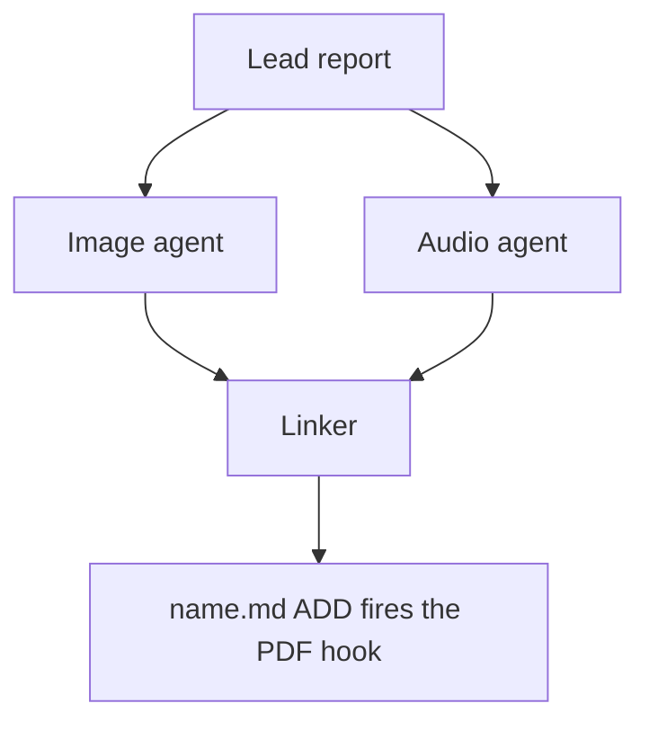

Decide whether Mermaid diagrams would help a reader understand the lead's research
report and, if so, write them to a companion manifest for the swarm linker to place.
The linker is the only publisher: you propose, it places or omits.

## 1. Scope and source

- Never edit the report, never write a report of your own, and create no other file in
  the research checkout (`$(sase repo path research --ensure)`). Keep scratch files in a
  fresh `mktemp -d` directory outside it.
- Read the report once with `sase artifact read` on the registered lead entry listed
  above (its `ref`, or its `research:` label), redirecting the output to a scratch copy.
  Never work from memory or the forked conversation alone.
- If no registered lead report is listed, propose nothing and set `status: failed` with
  that reason (step 7).
- If this prompt also asked for an infographic, finish it first and do not repeat what
  it shows.

## 2. Decide

Zero is a normal outcome, and the usual one for surveys and recommendation lists.
Propose a diagram only when all of these hold:

- the report describes three or more connected parts: a flow, a state lifecycle, an
  exchange between actors over time, a dependency structure, or a phased plan;
- a reader would grasp it faster from the picture than from the prose;
- every box, arrow, and label restates something the report says;
- it does not repeat the infographic, a Mermaid diagram already in the report, a table,
  or a short list. Never turn a table into a diagram.

Propose at most three. Add no actors, steps, numbers, orderings, or causal arrows the
report does not state. Conditional wording stays conditional, and a proposed design
stays distinct from an implemented one.

## 3. Draw

Size each diagram for a PDF column about 650 px wide and at most about half a page tall.

- Types: `flowchart` (prefer `TD`; use `LR` only for a chain of five or fewer short
  nodes), `sequenceDiagram` (at most four participants), `stateDiagram-v2`,
  `classDiagram`, `erDiagram`.
- No init directives, `click`, `style`, `classDef`, HTML, or icons.
- At most four boxes side by side and about five ranks. In `TD` flows avoid decision
  diamonds and put the condition on a labelled edge instead.
- Labels of about four words or fewer, in the report's terms. Quote every label
  (`A["Lead report"]`, `-->|"on failure"|`). Never use `end` as a node id.

## 4. Validate

Put every diagram in a scratch Markdown file with a short paragraph before each one,
then render it:

```sh
bob ref create <scratch>/check.md -o <scratch>/check_render.pdf -n -P <parent>
```

- `-n` is `--no-audio`, not a dry run. Writing `-o` outside the library leaves no vault
  state, and the output PDF stem must differ from the Markdown stem.
- `-P` is required and must name an existing Bob area or project note. Use the SASE
  project's display name, the value the Highlights hook passes (`display_name` in
  `sase project current --json`). If bob rejects it, rerun with any note listed by
  `bob capture-targets`; the parent does not affect the check.
- Every diagram must render (`diagrams: rendered N of N Mermaid diagrams`) with no
  `warning:` lines. Fix, simplify, or drop failing diagrams, and stop after three rounds.
- If bob is missing or the check cannot run, propose nothing and set `status: failed`
  with the reason (step 7).

## 5. Anchor

For each kept diagram, choose an `anchor`: 5-20 words copied verbatim from _one line_ of
a body paragraph or list item in the report. Headings, table rows, code blocks, and
existing Mermaid fences never qualify. Confirm `grep -cF -- '<anchor>' <scratch-copy>`
prints `1`; if no unique anchor exists, drop the diagram.

## 6. Write the manifest

Write `<stem>.diagrams.md` beside the report, without overwrite, where `<stem>` is the
report's stem with any trailing `__final` removed, following the `#research/image` stem
rule (so `topic__final.md` becomes `topic.diagrams.md`). If it already exists, stop
diagram work, register nothing, and set `status: failed` naming the collision (step 7).
Write no file when no diagram survived.

Keep all metadata in the body, never in frontmatter: `sase artifact read` strips YAML
frontmatter. Use no local paths and no `file:` refs; the research repo is public.

````markdown
# Diagram proposals: <report title>

Proposals for the swarm linker, not a report. Each diagram restates only what the source
report says.

```yaml
source: research:<YYYYMM>/<name>/<name>__final.md
producer: <this agent's name>
check: "diagrams: rendered 1 of 1 Mermaid diagrams"
```

## publication-order

```yaml
anchor: |-
  so the link must be in the linker's first commit.
illustrates: |-
  The linker waits for every companion agent because the PDF hook fires once, on the
  ADD of name.md.
caption: The linker publishes once, after every companion finishes.
```


````

- `source` is the report's `research:` label, `producer` is your agent name, and `check`
  is bob's `diagrams:` line.
- Each `## <id>` is a unique lowercase slug. `anchor` is a YAML literal block, so
  backticks and quotes copy exactly. `illustrates` is one sentence in the report's own
  terms stating the point the diagram makes. `caption` is at most about 15 words and has
  no figure number.
- Each `mermaid` fence is byte-identical to the source that passed the check; rerun the
  check after any edit.

## 7. Register and report

- When a manifest exists, register it without `--move`:
  `sase artifact create -p "<abs-path>" -l "diagrams:<YYYYMM>/<name>/<stem>.diagrams.md"`.
  The `diagrams:` label keeps it out of every `research:` listing.
- Then always set the `diagrams` variable, including when you proposed nothing. A missing
  variable means unknown or failed, never "considered and declined". It never carries
  Mermaid bodies:

  ```sh
  sase var set diagrams --json --value '{"status": "ready", "count": 2, "manifest": "<YYYYMM>/<name>/<stem>.diagrams.md", "source_ref": "<lead ref>"}'
  sase var set diagrams --json --value '{"status": "none", "count": 0, "reason": "Survey of options; no flow to draw."}'
  sase var set diagrams --json --value '{"status": "failed", "count": 0, "reason": "bob render check unavailable on this host"}'
  ```

- A diagram failure never fails this agent. Finish normally so the linker can publish,
  and mention the outcome in your final response.
